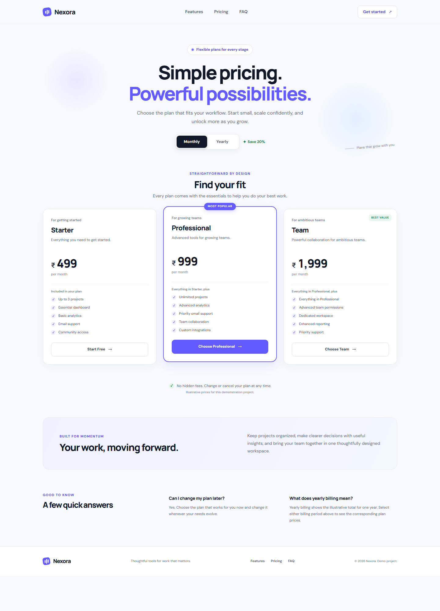
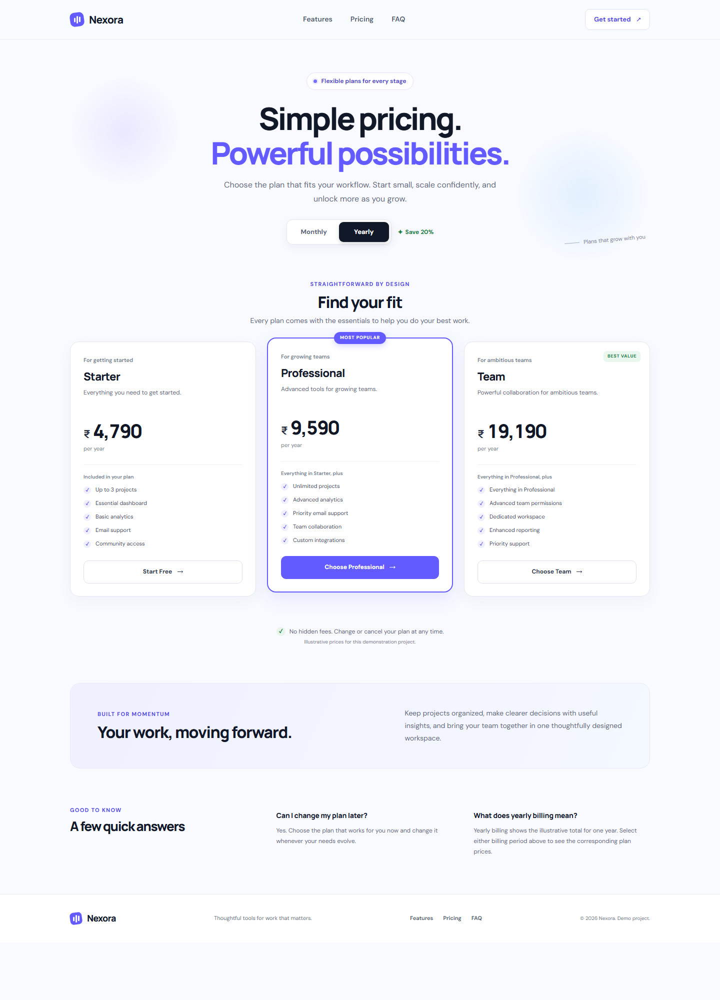

# Responsive Product Pricing Cards

A polished, responsive pricing page for Nexora, a fictional SaaS product. The project demonstrates semantic HTML, modern CSS, responsive layouts, accessibility, and interactive billing controls using plain JavaScript.

> Prices are illustrative project content and are not real commercial offers.

## Features

- Three fictional plans: Starter, Professional, and Team.
- Interactive monthly and yearly billing controls.
- Indian rupee formatting with `Intl.NumberFormat`.
- Popular Professional plan styling and responsive mobile ordering.
- Accessible plan selection feedback and keyboard-operable buttons.
- Responsive navigation, FAQ, trust statement, and footer.
- Reduced-motion support and visible focus styles.
- No framework, build step, payment flow, or third-party runtime dependency.

## Technology stack

- HTML5
- CSS3 (Grid, Flexbox, media queries, custom properties)
- Vanilla JavaScript
- Google Fonts (Manrope and DM Sans; system sans-serif fallbacks are provided)

## Folder structure

```text
.
├── index.html
├── style.css
├── script.js
└── README.md
```

## Run locally

Open `index.html` directly in a browser, or serve the folder over HTTP:

1. Open this folder in VS Code.
2. Install/use the Live Server extension and choose **Open with Live Server** on `index.html`.
3. Alternatively, from this folder run `python -m http.server 8000`, then visit `http://localhost:8000`.

The page uses relative paths, so the same files work from a repository subpath or a static hosting provider.

## Billing toggle

Monthly and Yearly are separate HTML buttons. Each plan price stores its source values in `data-monthly` and `data-yearly`; `script.js` reads those attributes, formats them as Indian rupees, updates the billing labels, and keeps each button's `aria-pressed` state in sync. Monthly is selected at page load. Plan CTAs show an accessible confirmation naming the selected plan and billing period; they do not start a purchase or collect payment details.

## Responsive design

- Three equal columns on wide screens.
- A single-column card layout at viewport widths of 800px and below.
- The Professional plan moves first in the mobile card stack.
- Header and card spacing adapt for narrow screens, including 360px-wide devices.
- Feature and FAQ content use CSS layouts that reflow without JavaScript.

## Accessibility

- Semantic landmarks, a skip link, and a logical heading structure.
- Descriptive button names and accessible billing-period pressed states.
- Visible keyboard focus indicators and a live status region for CTA feedback.
- The selected billing option is indicated by both color and text/pressed state.
- Reduced-motion preferences disable nonessential movement and transitions.
- Decorative icons are hidden from assistive technology where appropriate.

## Testing checklist

- [ ] Monthly selected on first load; all three monthly prices are correct.
- [ ] Yearly and Monthly can be toggled repeatedly; labels and `aria-pressed` update.
- [ ] Yearly totals are below twelve monthly payments for each plan.
- [ ] Exactly three cards are present, each with five features.
- [ ] Professional has the popular styling and is first on mobile.
- [ ] Each CTA announces the correct plan and current billing period.
- [ ] Keyboard focus, links, reduced motion, and hover styling work.
- [ ] Verify layout at 360, 390, 768, 1024, 1280, and 1440px.
- [ ] Check for horizontal overflow and browser console errors.

The supplied project consists of static HTML, CSS, and JavaScript. Automated browser testing is not included; use the checklist above when checking it in your target browsers.

## Screenshots

Both screenshots were captured at the same desktop viewport and include the billing switch and all three pricing cards.

### Monthly billing



### Yearly billing



## Deployment

### GitHub Pages

1. Create a GitHub repository and add these project files to its root.
2. Push the files to the repository's default branch.
3. In the repository settings, open **Pages** and select **Deploy from a branch**.
4. Choose the default branch and `/ (root)`, then save. GitHub Pages will provide the published URL when deployment completes.

### Netlify

Create a new site from your Git repository and use the repository root as the publish directory. No build command is required. Alternatively, drag and drop the project folder into Netlify's manual deploy area.

Deployment has not been performed as part of this project; publishing requires access to your GitHub or Netlify account.

## Final submission checklist

- [ ] Add source files to your GitHub repository.
- [ ] Test desktop and mobile layouts in a browser.
- [ ] Capture Monthly and Yearly screenshots.
- [ ] Complete the interaction and accessibility checklist.
- [ ] Publish through GitHub Pages or Netlify and verify the live URL.

## Author

Your Name — [GitHub profile](https://github.com/your-username)
